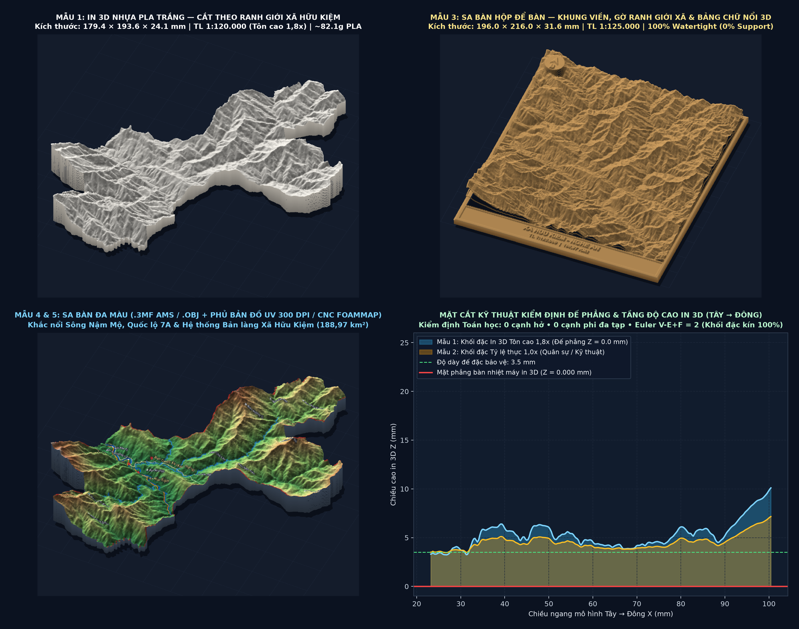

# 🌐 MÔ HÌNH ĐỊA HÌNH IN 3D — XÃ HỮU KIỆM, TỈNH NGHỆ AN

### 👉 [BẤM VÀO ĐÂY ĐỂ MỞ XEM TRƯỚC MÔ HÌNH 3D TRỰC TUYỆT (FULL 3D WEBGL)](https://cuongsmileks.github.io/mo-hinh-3d-xa-huu-kiem/)

🔗 **Link mở trực tiếp trên mọi máy tính / điện thoại:**
**https://cuongsmileks.github.io/mo-hinh-3d-xa-huu-kiem/**

---
> **Lưu ý:** Trên trang github.com, khi bấm vào tên file .html thì GitHub chỉ hiển thị mã nguồn (code). Để mở giao diện xoay 3D tương tác như phần mềm, vui lòng bấm vào đường link **cuongsmileks.github.io** phía trên hoặc bấm trực tiếp vào bức ảnh xem trước!